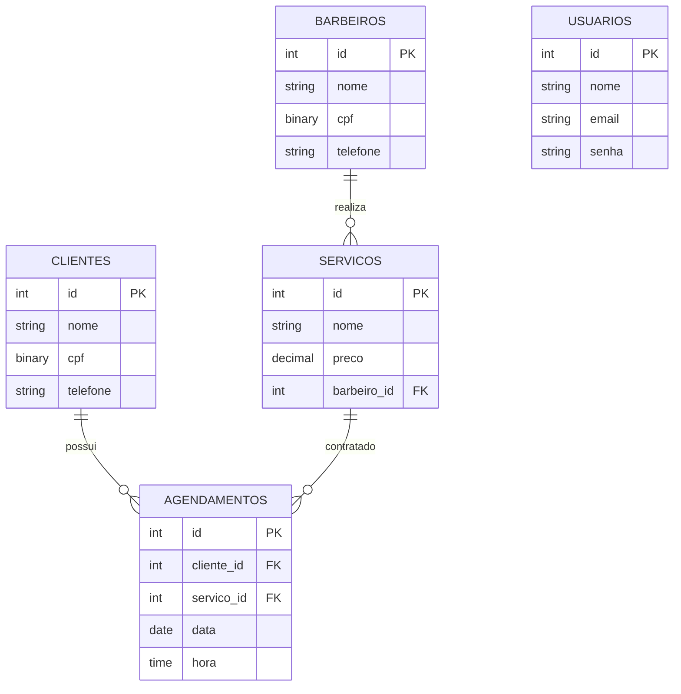

# Sistema Barbearia – Documentação

## Objetivo
Gerenciar clientes, barbeiros, serviços e agendamentos, com login (token expira em 1h) e dados sensíveis criptografados (LGPD).

## Requisitos Funcionais
- RF01 – Login com validação e mensagem de erro (usuário/senha inválidos).
- RF02 – Painel principal com nome do usuário, navegação e logout.
- RF03 – Cadastro, listagem e busca de clientes.
- RF04 – Cadastro de barbeiros.
- RF05 – Cadastro de serviços vinculados a um barbeiro (obrigatório).
- RF06 – Agendamento de atendimentos, listagem ordenada por data e hora com dados de cliente, serviço e barbeiro.

## Requisitos Não Funcionais
- RNF01 – Senha com bcrypt (pgcrypto crypt); CPF com pgp_sym_encrypt.
- RNF02 – Autenticação JWT com expiração.
- RNF03 – Stack: Node.js, Express, PostgreSQL, HTML/JS.

## Como executar
1. Criar o banco `saep_db` no pgAdmin e rodar `saep_db.sql` no Query Tool.
2. `cd sistema && npm init -y && npm i express pg jsonwebtoken`
3. `node server.js` → http://localhost:3000
4. Login: `admin@barbearia.com` / `123456`

## DER (Mermaid – exportar como PNG em mermaid.live)

